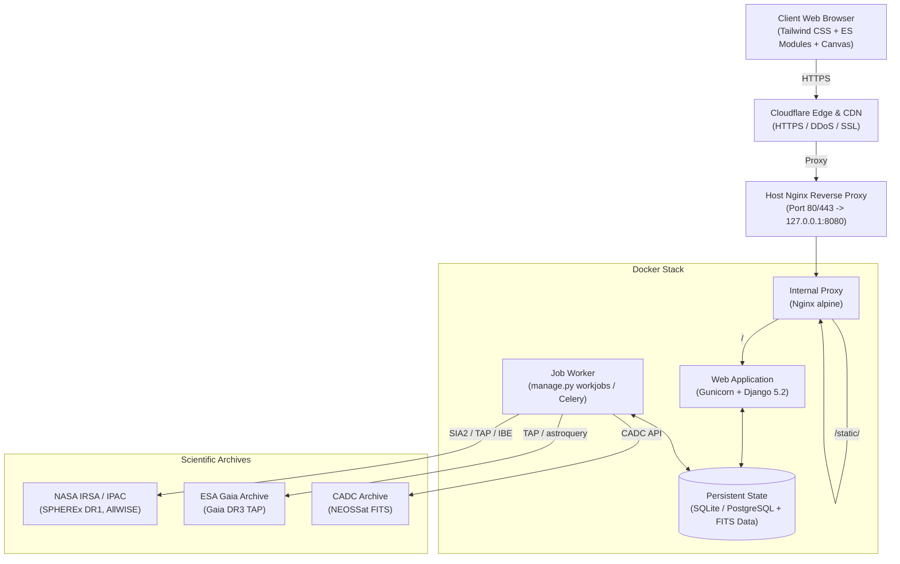

# Argus · Infrared Sky Observation & Analysis Workspace

<div align="center">

[](https://skyargus.space)
[](https://skyargus.space)
[](https://www.python.org/)
[](https://www.djangoproject.com/)
[](https://www.docker.com/)
[](LICENSE)

**A rigorous, reproducible astronomical web workspace for exploring real infrared sky observations, multi-channel spectral data cubes, celestial transients, and immutable research reports.**

[🌐 Explore the Sky on skyargus.space](https://skyargus.space) · [📖 Documentation](docs/) · [🧪 Test Plan](docs/TEST_PLAN.md) · [🛰️ Data Integrations](docs/RESOURCE_INTEGRATION.md)

</div>

---

## 🔭 Overview & Purpose

**Argus** is an astronomy workspace built for researchers, citizen scientists, and students to discover, inspect, and analyze real multi-epoch infrared sky data. 

Unlike conventional sky viewers that serve pre-rendered image tiles or synthetic mockups, Argus enforces a strict scientific principle: **Zero fabricated sky, no invented data, and complete processing provenance.** Every observation traces back to authentic calibrated FITS files from missions such as NASA's **SPHEREx**, ESA's **Gaia**, and the **AllWISE / NEOSSat** archives.

Argus empowers users to navigate through multi-spectral channels, extract quick-look aperture spectra with error bounds, perform blink comparisons, compute difference images, stack epochs with inverse-variance weights, and publish peer-reviewable immutable investigation reports.

---

## 🌟 Key Capabilities

### 1. 🌈 102-Channel SPHEREx Spectral Cube Explorer
- **Multi-Wavelength Plane Navigation:** Traverse through all 102 spectral channels of the SPHEREx mission (0.75 µm to 5.0 µm) across genuine archive HPX tiles.
- **Wavelength Workbench & Player:** Interactive wavelength stepping, loop playback, speed controls, and synchronized multi-channel drill-through.
- **A/B Comparison Suite:**
  - **Blink Comparator:** Toggle between alternating observation dates or bands at matched sky positions.
  - **Swipe & Split Comparison:** Synchronized side-by-side or curtain swipe with preserved non-square aspect ratios.
  - **Shared Stretch:** Normalized asinh, log, or linear contrast mapping without modifying raw measured pixel photometry.

### 2. 🎯 Precision Celestial Target & Coordinate Engine
- **Flexible Coordinates:** Supports decimal degrees (`RA 269.452075°, Dec +4.693391°`) and sexagesimal formats (`17h57m48.5s +04d41m36s`) with boundary sanity checks.
- **Catalog Name Resolver:** Live query resolver for stellar names, high-proper-motion targets, and infrared landmarks.
- **Curated Target Presets:**
  - **Barnard's Star:** Rapid proper motion tracking in high-cadence epochs.
  - **WISE 0855−0714:** Sub-stellar brown dwarf exploration in mid-infrared.
  - **Epsilon Indi B:** Nearby binary brown dwarf benchmark.
  - **RW Aurigae & R Draconis:** Classical variable young stellar objects.
- **Bounded Field of View (FOV):** Custom FOV from 1 to 20 arcminutes with pixel-scale preservation.

### 3. 📊 Aperture Photometry & Spectrum Extraction
- **Adapted Caltech/IPAC Pipeline:** Quick-look aperture extraction adapted from the official SPHEREx Source Discovery Tool.
- **Un-reprojected Native Cutouts:** Performs photometry directly on original FITS data, avoiding reprojection resampling artifacts.
- **Annulus Background Subtraction:** Circular target aperture with concentric background annulus for local sky subtraction.
- **Error Propagation:** Tracks detector variance, converts surface brightness (MJy/sr) to flux density (mJy), and applies bad pixel masks (`MSKN`).
- **Data Export:** Instant download of spectral measurements in JSON format and raw FITS cubes.

### 4. ⏱️ Multi-Epoch Motion & Transient Analysis
- **Chronological Playback:** Step through dated sequence exposures to isolate variable stars, asteroids, or high-proper-motion objects.
- **Difference Imaging:** Zero-centered frame residual computation ($B - A$) with propagated variance ($\sigma_B^2 + \sigma_A^2$).
- **Inverse-Variance Epoch Stacking:** Co-add multiple frames on a common celestial grid, rejecting bad detector pixels (hot, cold, dead, missing).
- **False-Color RGB Composites:** Map three distinct infrared spectral bands into 3-channel RGB visualizers with explicit bandpass labeling.

### 5. 🗺️ Multi-Mission Reference Overlays
- **Gaia DR3 Astrometry:** Real-time TAP queries against ESA Gaia DR3 for high-precision stellar positions and reference epochs.
- **AllWISE / CatWISE:** IRSA TAP overlay querying mid-infrared counterparts.
- **NEOSSat Space Telescope:** Native raw optical FITS sequence inspection and CADC archive integration.

### 6. 📝 Immutable Investigation Reports
- **Session-Private Workspace:** Mark candidates, record private investigation notes, and classify findings (motion, variability, artifact, unsure).
- **Cryptographic Revision Chains:** Generate tamper-evident, read-only report permalinks preserving exact coordinate states, observation IDs, display settings, and warnings.
- **Export Formats:** High-resolution annotated PNGs, printable summaries, structured JSON metadata, and display-grid FITS files.

---

## 🛠️ Architecture & Tech Stack



| Layer | Technologies |
| :--- | :--- |
| **Backend Framework** | Python 3.13, Django 5.2, Gunicorn |
| **Astrophysics Engines** | Astropy, Reproject, Photutils, SciPy, NumPy, Astroquery, PyVO |
| **Asynchronous Engine** | Celery / Database Worker (`workjobs`), Redis / SQLite queue |
| **Frontend UI** | HTML5 Canvas, Tailwind CSS, Vanilla ECMAScript (zero heavy JS framework overhead) |
| **Infrastructure** | Docker, Docker Compose, Nginx Reverse Proxy, Cloudflare CDN |

---

## 🚀 Quickstart & Local Setup

### Prerequisites
- Python 3.13+
- Node.js 20+ (for building Tailwind CSS assets)
- Git

### 1. Clone & Set Up Virtual Environment

```bash
git clone https://github.com/itsDevlune/skyargus.git
cd skyargus

# Create and activate virtual environment
python -m venv .venv
source .venv/bin/activate  # On Windows: .venv\Scripts\activate

# Install locked dependencies
pip install -r requirements.lock
```

### 2. Build Frontend Static Assets

```bash
npm ci
npm run build
```

### 3. Initialize Database & Run

```bash
# Run migrations and collect static files
python manage.py migrate
python manage.py collectstatic --noinput

# Start development web server
python manage.py runserver 127.0.0.1:8000
```

In a separate terminal, start the background worker to handle archive ingestion jobs:

```bash
python manage.py workjobs --recover
```

Open **http://127.0.0.1:8000** in your browser.

---

## 🐳 Production Deployment (Docker Compose)

### Host Nginx + Docker Compose (Recommended VPS Setup)

This repository includes a production-tested standalone profile running behind a host Nginx reverse proxy (as deployed on `skyargus.space`):

1. **Configure Environment:**
   ```bash
   cp .env.example .env
   # Edit .env and set SECRET_KEY, ALLOWED_HOSTS, etc.
   ```

2. **Build and Launch Stack:**
   ```bash
   docker compose -f compose.tunnel.yaml -f compose.nginx.yaml up --build -d
   ```

3. **Configure Host Nginx Reverse Proxy:**
   Point your domain to `http://127.0.0.1:8080`. Sample Nginx configuration is available in [docs/NGINX_REVERSE_PROXY.md](docs/NGINX_REVERSE_PROXY.md).

4. **Verify Health:**
   ```bash
   curl -I http://127.0.0.1:8080/health/
   ```

---

## 🧪 Scientific Verification & Tests

Argus includes extensive test coverage across coordinate geometry, numerical variance propagation, archive error handling, and browser interactions.

```bash
# Run backend pytest suite (analytical rigor, models, coordinates, APIs)
pytest

# Run code style and linting audit
ruff check .

# Run Playwright end-to-end browser regressions
npx playwright test
```

Read [docs/TEST_PLAN.md](docs/TEST_PLAN.md) and [docs/FEATURES.md](docs/FEATURES.md) for the verified acceptance evidence ledger.

---

## 📑 Scientific Limitations & Disclosures

- **Photometric Comparability:** Overlapping nominal display bandpasses do not constitute cross-detector photometric calibration.
- **Aperture Photometry:** Quick-look extraction performs background-subtracted circular aperture integration; Point Spread Function (PSF) fitting is not performed.
- **Astrometric Associations:** Manual position marking tracks pixel centers; proper motion fits use user-defined position uncertainty and do not compute orbital mechanics or hazard ratings.
- **Catalog Overlays:** Gaia DR3 and AllWISE markers display catalog reference coordinates (Epoch J2016.0); proper motion vector propagation is documented per overlay.

---

## 🤝 Acknowledgements & Data Citations

- **NASA / IPAC Infrared Science Archive (IRSA):** SPHEREx Data Release 1 (DR1) and Quick Release 3 (QR3), AllWISE data access.
- **European Space Agency (ESA):** Gaia Data Release 3 (Gaia DR3) catalog data.
- **Canadian Astronomy Data Centre (CADC):** NEOSSat microsatellite imaging sequences.
- **Caltech / IPAC SPHEREx Science Team:** Aperture photometry algorithms adapted from the SPHEREx Source Discovery Tool.
- **NASA Space Apps Challenge:** Created as an open-source science application for space observation and transient analysis.

---

<div align="center">

Made with 🔭 for astronomy and open science · **[Visit skyargus.space](https://skyargus.space)**

</div>
